

<picture>
  <source media="(prefers-color-scheme: dark)" srcset="assets/hero-dark.svg">
  <source media="(prefers-color-scheme: light)" srcset="assets/hero-light.svg">
  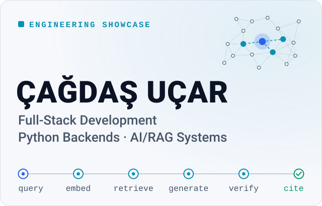
</picture>

  <a href="https://cagdas-webdesign.github.io/portfolio/"><b>Live Portfolio</b></a>
  &nbsp;·&nbsp;
  <a href="https://github.com/Cagdas-Webdesign/portfolio-rag-backend"><b>RAG Backend</b></a>
  &nbsp;·&nbsp;
  <a href="mailto:ucarcagdas18@gmail.com"><b>ucarcagdas18@gmail.com</b></a>

I build complete web applications — the interface, the Python backend and the language models
behind it. My focus is AI systems that can be checked: answers grounded in real sources, failures
handled explicitly, and quality measured by tests and evaluation rather than asserted.

<picture><source media="(prefers-color-scheme: dark)" srcset="assets/proof-tests-dark.svg"><source media="(prefers-color-scheme: light)" srcset="assets/proof-tests-light.svg">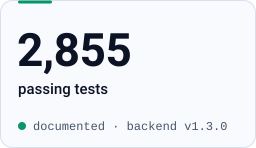</picture>
<picture><source media="(prefers-color-scheme: dark)" srcset="assets/proof-acceptance-dark.svg"><source media="(prefers-color-scheme: light)" srcset="assets/proof-acceptance-light.svg">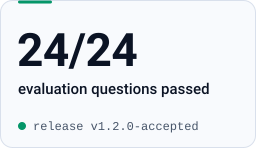</picture>
<picture><source media="(prefers-color-scheme: dark)" srcset="assets/proof-adrs-dark.svg"><source media="(prefers-color-scheme: light)" srcset="assets/proof-adrs-light.svg">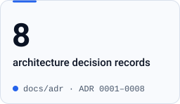</picture>

Test count from the backend <a href="https://github.com/Cagdas-Webdesign/portfolio-rag-backend#evaluation-and-testing">README</a> (v1.3.0) ·
24/24 from the <a href="https://github.com/Cagdas-Webdesign/portfolio/blob/main/public/evaluation/final-acceptance-v1.2.0.md">v1.2.0 acceptance report</a>, not yet repeated for v1.3.0 ·
<a href="https://github.com/Cagdas-Webdesign/portfolio-rag-backend/tree/main/docs/adr">ADRs</a>. 
Tests and evaluation document behaviour; they do not guarantee production reliability.

---

## Portfolio RAG Backend

**Flagship project** · Python 3.13 · FastAPI · v1.3.0 in production on Google Cloud Run

[Repository](https://github.com/Cagdas-Webdesign/portfolio-rag-backend) ·
[Architecture](https://github.com/Cagdas-Webdesign/portfolio-rag-backend/blob/main/docs/ARCHITECTURE.md) ·
[Evaluation](https://github.com/Cagdas-Webdesign/portfolio-rag-backend/blob/main/evaluation/README.md) ·
[Security](https://github.com/Cagdas-Webdesign/portfolio-rag-backend/blob/main/docs/SECURITY.md)

A portfolio assistant must never invent a skill or a project — that would be a false statement
about a real person. This backend answers only from a reviewed knowledge base, verifies every answer
against the passages it cites, and says so when it does not know. The RAG pipeline is written in the
repository instead of an orchestration framework such as LangChain: chunking, retrieval, grounding
and citations decide answer quality, so they are kept small enough to measure and change on purpose.

### How a question is answered

**React portfolio → Cloudflare Worker** (Turnstile, rate limits) **→ FastAPI on Google Cloud Run**,
then six steps inside the backend:

<picture><source media="(prefers-color-scheme: dark)" srcset="assets/query-1-embed-dark.svg"><source media="(prefers-color-scheme: light)" srcset="assets/query-1-embed-light.svg">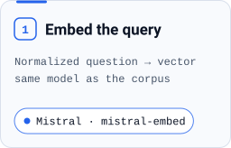</picture>
<picture><source media="(prefers-color-scheme: dark)" srcset="assets/query-2-retrieve-dark.svg"><source media="(prefers-color-scheme: light)" srcset="assets/query-2-retrieve-light.svg">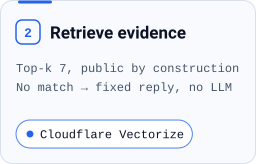</picture>
<picture><source media="(prefers-color-scheme: dark)" srcset="assets/query-3-context-dark.svg"><source media="(prefers-color-scheme: light)" srcset="assets/query-3-context-light.svg">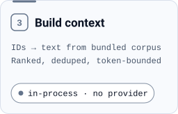</picture>
<picture><source media="(prefers-color-scheme: dark)" srcset="assets/query-4-generate-dark.svg"><source media="(prefers-color-scheme: light)" srcset="assets/query-4-generate-light.svg">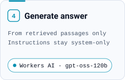</picture>
<picture><source media="(prefers-color-scheme: dark)" srcset="assets/query-5-verify-dark.svg"><source media="(prefers-color-scheme: light)" srcset="assets/query-5-verify-light.svg">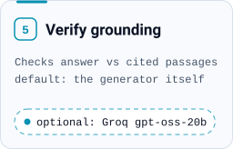</picture>
<picture><source media="(prefers-color-scheme: dark)" srcset="assets/query-6-cite-dark.svg"><source media="(prefers-color-scheme: light)" srcset="assets/query-6-cite-light.svg">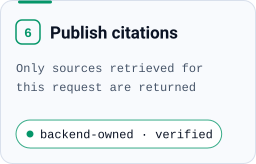</picture>

The answer and its citations return through the Worker with an `X-Request-ID`.

### How knowledge is indexed

Offline, from the CLI (`portfolio-rag knowledge index`) — never inside a request. The corpus also
ships in the container image, so retrieved IDs resolve back to text locally.

<picture><source media="(prefers-color-scheme: dark)" srcset="assets/ingest-1-author-dark.svg"><source media="(prefers-color-scheme: light)" srcset="assets/ingest-1-author-light.svg">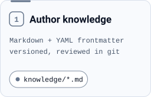</picture>
<picture><source media="(prefers-color-scheme: dark)" srcset="assets/ingest-2-validate-dark.svg"><source media="(prefers-color-scheme: light)" srcset="assets/ingest-2-validate-light.svg">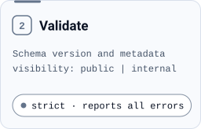</picture>
<picture><source media="(prefers-color-scheme: dark)" srcset="assets/ingest-3-chunk-dark.svg"><source media="(prefers-color-scheme: light)" srcset="assets/ingest-3-chunk-light.svg">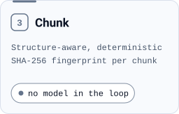</picture>
<picture><source media="(prefers-color-scheme: dark)" srcset="assets/ingest-4-plan-dark.svg"><source media="(prefers-color-scheme: light)" srcset="assets/ingest-4-plan-light.svg">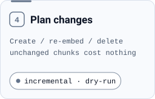</picture>
<picture><source media="(prefers-color-scheme: dark)" srcset="assets/ingest-5-embed-dark.svg"><source media="(prefers-color-scheme: light)" srcset="assets/ingest-5-embed-light.svg">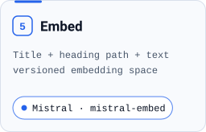</picture>
<picture><source media="(prefers-color-scheme: dark)" srcset="assets/ingest-6-index-dark.svg"><source media="(prefers-color-scheme: light)" srcset="assets/ingest-6-index-light.svg">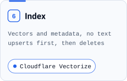</picture>

### What the code demonstrates

- **Ports and adapters** — every model and store sits behind an interface; one composition module
  turns configuration into providers, so swapping one is a config change, not a refactor.
- **Controlled unknowns** — no evidence above the similarity threshold means a fixed answer, an
  empty citation list and no language-model call.
- **Security boundaries** — public-only retrieval is part of the query, retrieved text cannot become
  an instruction, requests that bypass the edge gateway are refused, and questions and answers are
  never logged. Prompt injection is documented as a residual risk, not declared solved.
- **Quality gates** — Ruff, mypy `strict`, pytest and a Docker smoke test run in
  [CI](https://github.com/Cagdas-Webdesign/portfolio-rag-backend/blob/main/.github/workflows/ci.yml)
  on every push; CI also asserts that a production container refuses to start with development
  stand-ins.
- **Measured retrieval** — in the v1.2.0 acceptance: hit@1 75 %, hit@5 90 %, MRR 0.817 on 20
  answerable questions, with every failing question listed by name.

---

## Interactive React Portfolio

**Frontend counterpart** · React 19 · JavaScript · Vite 8

[Live site](https://cagdas-webdesign.github.io/portfolio/) ·
[Repository](https://github.com/Cagdas-Webdesign/portfolio)

The user interface of the RAG system, and a frontend work sample in its own right.

- **Integrated assistant** — asks the backend through the Cloudflare Worker and shows each answer
  with the sources it was built from; rate limits and timeouts are explicit error states.
- **System visualisations** — interactive views of the RAG architecture and knowledge pipeline, and
  the release-acceptance report rendered inside the site.
- **Motion with restraint** — GSAP with ScrollTrigger, Framer Motion and Lottie, respecting
  `prefers-reduced-motion`.
- **Delivery** — responsive layout, oxlint and `node:test`, deployed to GitHub Pages by a GitHub
  Actions workflow.

---

## Engineering principles

- **Architecture** — a modular monolith with enforced boundaries;
  [eight ADRs](https://github.com/Cagdas-Webdesign/portfolio-rag-backend/tree/main/docs/adr) record
  decisions and the options deliberately rejected.
- **Evidence** — retrieval is scored with hit@k and MRR; thresholds change only after a measurement.
- **Controlled failure** — no evidence, no answer; unverified answers are not published, and a
  misconfigured production service does not start.
- **Quality gates** — lint, strict typing, tests and a container smoke test in CI before work counts
  as done.
- **Traceability** — request IDs end to end and content-free telemetry for every provider call;
  operational metrics live in a separate, non-public dashboard.
- **AI-assisted, human-directed** — I own architecture, scope and quality decisions; implementation
  is AI-assisted and passes the same automated checks.

---

## Technologies

**Used in the featured projects**

`Python` `FastAPI` `Pydantic` `pytest` `Ruff` `mypy`
`React` `JavaScript` `Vite` `GSAP` `Framer Motion` `Lottie`
`Mistral embeddings` `Cloudflare Vectorize` `Cloudflare Workers AI` `Groq`
`Docker` `Google Cloud Run` `Cloudflare Workers` `Turnstile` `GitHub Actions` `GitHub Pages`

**Additional experience** — not used in the repositories above

`Java` `TypeScript` `PHP` `WordPress` `WooCommerce` `PostgreSQL` `Supabase` `n8n` `Workflow automation`

---

## Contact

Open to roles in full-stack development, Python backends and AI / RAG application development.

**[ucarcagdas18@gmail.com](mailto:ucarcagdas18@gmail.com)** ·
**[Live Portfolio](https://cagdas-webdesign.github.io/portfolio/)**
