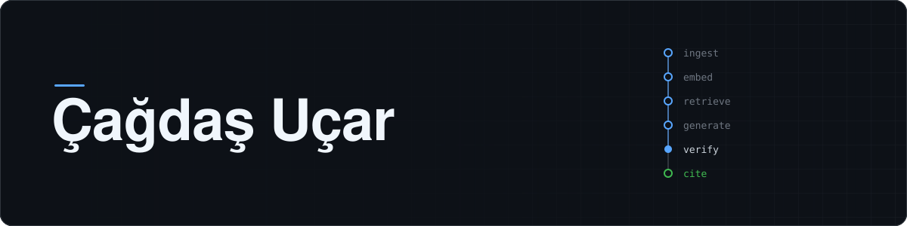
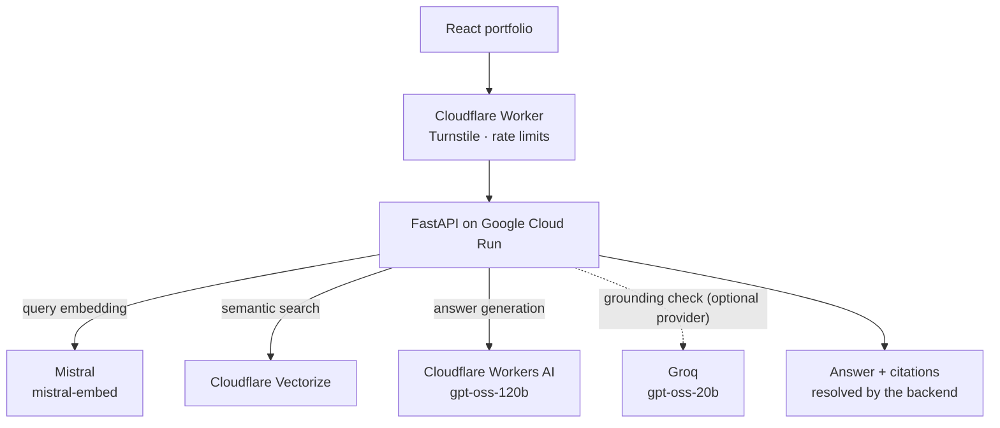

<picture>
  <source media="(prefers-color-scheme: dark)" srcset="assets/header-dark.svg">
  <source media="(prefers-color-scheme: light)" srcset="assets/header-light.svg">
  
</picture>

### Full-Stack Development · Python Backends · RAG Applications

I build complete web applications — from the interface a visitor uses to the Python backend and the
language models behind it. My focus is retrieval-augmented generation that stays reliable, secure
and measurable: answers grounded in real sources, failures handled explicitly, and quality checked
by tests and evaluation rather than asserted.

**[Live Portfolio](https://cagdas-webdesign.github.io/portfolio/)** ·
**[RAG Backend Repository](https://github.com/Cagdas-Webdesign/portfolio-rag-backend)** ·
**[ucarcagdas18@gmail.com](mailto:ucarcagdas18@gmail.com)**

---

## Featured project — Portfolio RAG Backend

**[portfolio-rag-backend](https://github.com/Cagdas-Webdesign/portfolio-rag-backend)** · Python 3.13 · FastAPI · v1.3.0 in production

An assistant that answers questions about my work has an unusual failure mode: an invented skill or
project is a false statement about a real person. This backend answers only from a reviewed,
version-controlled knowledge base, verifies each answer against the passages it cites, and says so
when the knowledge base does not cover a question.

**Why a custom pipeline.** Ingestion, chunking, retrieval, context assembly, grounding and citation
validation are implemented in the repository instead of an orchestration framework such as
LangChain. These are the parts that decide answer quality, so they are kept small enough to measure
and change deliberately — a design decision for this system, not a verdict on frameworks.

**How a request flows.** The question is embedded with Mistral, matched against public chunks in
Cloudflare Vectorize, and assembled into a bounded context. Workers AI generates the answer; a
second call — on the generator itself or, when configured, on Groq — checks the answer against the
passages it cites. Only citations that resolve to chunks retrieved for that request are published.
If nothing relevant is retrieved, the service returns a fixed "not covered" answer without calling
a language model at all.

**Security boundaries.**

- Public-only retrieval is built into the query, not passed as a parameter.
- Retrieved text can never become a system instruction.
- The API refuses requests that bypass the edge gateway.
- Production refuses to start with development stand-ins.
- Questions, prompts and answers are never logged.

Residual risks, including prompt injection, are documented in
[SECURITY.md](https://github.com/Cagdas-Webdesign/portfolio-rag-backend/blob/main/docs/SECURITY.md).

**Architecture.** Modular monolith with ports and adapters: every model and store sits behind an
interface, and one composition module turns configuration into concrete providers. Eight
[architecture decision records](https://github.com/Cagdas-Webdesign/portfolio-rag-backend/tree/main/docs/adr)
document the choices that would be expensive to reverse.

### How quality is verified

| Evidence | Result | Scope |
| --- | --- | --- |
| Automated tests | 2,863 collected · 2,855 pass offline · 8 live tests skipped without credentials | documented for v1.3.0 |
| Quality gate | Ruff · mypy `strict` · pytest · Docker smoke test, on every push | [CI workflow](https://github.com/Cagdas-Webdesign/portfolio-rag-backend/blob/main/.github/workflows/ci.yml) |
| Release acceptance | 24/24 questions · 0 pipeline errors · 38/38 citations verified · 4/4 unanswerable questions refused | `v1.2.0-accepted` |
| Retrieval | hit@1 75 % · hit@3 85 % · hit@5 90 % · MRR 0.817 (20 answerable questions) | `v1.2.0-accepted` |

The acceptance and retrieval figures come from the live release acceptance of **v1.2.0**
([full report](https://github.com/Cagdas-Webdesign/portfolio/blob/main/public/evaluation/final-acceptance-v1.2.0.md));
they are not results for v1.3.0. How each number was measured is described in the
[evaluation guide](https://github.com/Cagdas-Webdesign/portfolio-rag-backend/blob/main/evaluation/README.md).

---

## Featured project — Interactive React Portfolio

**[Live site](https://cagdas-webdesign.github.io/portfolio/)** ·
**[Repository](https://github.com/Cagdas-Webdesign/portfolio)** · React 19 · JavaScript · Vite 8

A single-page portfolio that works as a frontend sample on its own and as the user interface of the
RAG system above.

- **Portfolio assistant** — talks to the backend through the Cloudflare Worker, shows answers with
  their sources, and handles rate limits and timeouts as explicit error states.
- **Technical storytelling** — interactive visualisations of the RAG architecture and knowledge
  pipeline, plus the release-acceptance report rendered inside the site.
- **Motion and interaction** — GSAP with ScrollTrigger, Framer Motion and Lottie, with
  `prefers-reduced-motion` respected.
- **Delivery** — responsive layout, linted with oxlint, tested with `node:test`, and deployed to
  GitHub Pages through a GitHub Actions workflow.

---

## Engineering principles

- **Evidence-based evaluation** — retrieval is scored with hit@k and MRR, every failing question is
  reported by name, and thresholds change only after a measurement.
- **Secure defaults** — the system fails closed: no evidence, no answer; an unverified answer is not
  published; a misconfigured production service does not start.
- **Explicit architecture decisions** — significant choices are written down as ADRs, and
  deliberately rejected options (re-ranking, agents, microservices) are documented with reasons.
- **Automated quality gates** — lint, strict type checking, tests and a container smoke test run in
  CI before anything is considered done.
- **Traceability and observability** — every request carries an ID, and each provider call leaves a
  content-free telemetry record. Operational metrics are reviewed in a separate dashboard built on
  Cloud Logging, Cloud Monitoring and Cloudflare Analytics; its source is not public.
- **Transparent AI-assisted development** — I direct architecture, scope and quality decisions;
  implementation is AI-assisted, and every change passes the same automated checks and review.

---

## Technologies

**Used in the featured projects**

| Area | Technologies |
| --- | --- |
| Backend | Python 3.13 · FastAPI · Pydantic v2 · Uvicorn · pytest · Ruff · mypy |
| AI & retrieval | Mistral embeddings · Cloudflare Vectorize · Cloudflare Workers AI · Groq |
| Frontend | React 19 · JavaScript · Vite 8 · GSAP · Framer Motion · Lottie |
| Infrastructure | Docker · Google Cloud Run · Cloudflare Workers & Turnstile · GitHub Actions · GitHub Pages |

**Additional experience** — not used in the repositories above:
TypeScript · Java · PHP · WordPress · WooCommerce · PostgreSQL · Supabase · n8n and workflow automation

---

## Contact

I am looking for opportunities in software development — Python backends, full-stack web
applications and AI / RAG integration.

**[ucarcagdas18@gmail.com](mailto:ucarcagdas18@gmail.com)** ·
**[Live Portfolio](https://cagdas-webdesign.github.io/portfolio/)**
